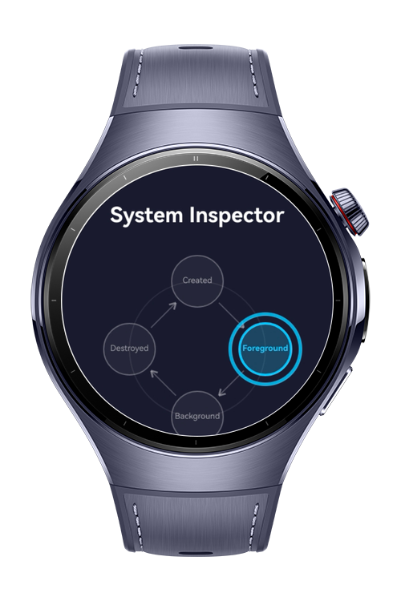
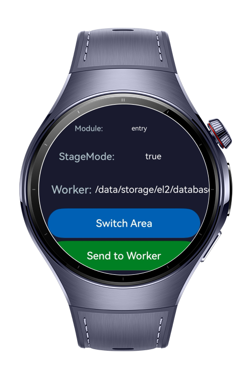
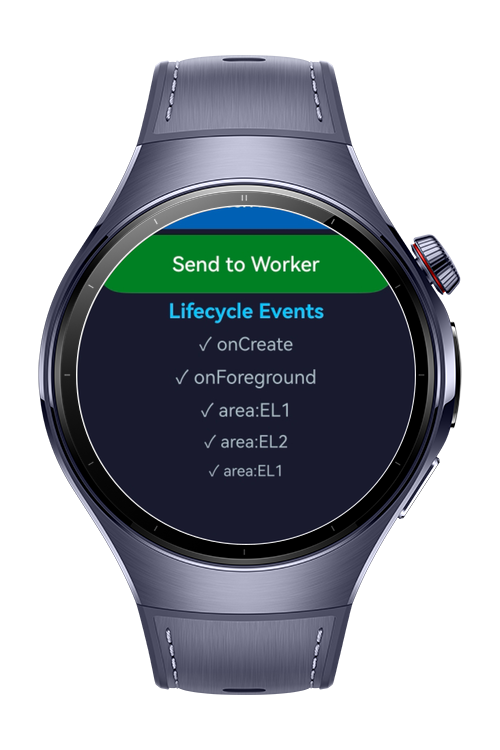
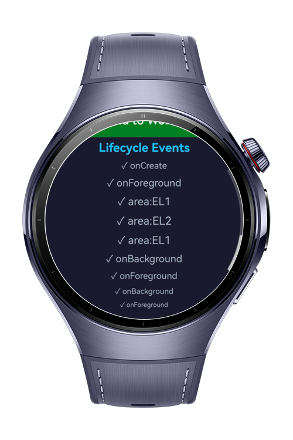

> **Note:** To access all shared projects, get information about environment setup, and view other guides, please visit [Explore-In-HMOS-Wearable Index](https://github.com/Explore-In-HMOS-Wearable/hmos-index).

# How to Build Ability Lifecycle Context

This codelab demonstrates the **AbilityKit application model APIs** on a HarmonyOS wearable device. The app implements a **System Inspector** that visualises the UIAbility lifecycle and the Stage model context hierarchy on a watch screen. An animated state diagram reacts in real time to lifecycle transitions, and a background Worker thread demonstrates thread-safe context transfer using the Sendable protocol.

# Preview

<div>
  
  
  
  
</div>

# Use Cases

- **Visualise UIAbility lifecycle** — launch the app and navigate away to watch `onCreate`, `onForeground`, `onBackground` fire in sequence on the animated state diagram and the scrollable lifecycle log.
- **Inspect the context hierarchy** — the Module info row reads `AbilityStageContext.currentHapModuleInfo.name` before any UIAbility is created, demonstrating the stage-level context available earlier in the process lifecycle.
- **Read BaseContext** — the StageMode row reads `BaseContext.stageMode` from inside `UIAbility.onCreate()`, confirming the Stage model is active.
- **Switch encryption area** — tap "Switch Area" to toggle `context.area` between `contextConstant.AreaMode.EL1` and `EL2`. The result appears as a log entry (`area:EL1` / `area:EL2`).
- **Pass context to a Worker thread** — tap "Send to Worker" to convert `UIAbilityContext` to a `SendableContext` via `sendableContextManager.convertFromContext()`, pass it by reference to a Worker, convert it back with `convertToContext()`, and display the resolved `databaseDir` path — which changes between `/el1/` and `/el2/` depending on the current area mode.

# Tech Stack

- **Languages:** ArkTS
- **Frameworks:** HarmonyOS SDK, API version 6.0.1(21)+
- **Tools:** DevEco Studio 6.0.1 or later
- **Libraries & Kits:**
    - `@kit.AbilityKit` — `UIAbility`, `AbilityStage`, `AbilityStageContext`, `BaseContext`, `contextConstant.AreaMode`, `sendableContextManager`, `SendableContext`
    - `@kit.ArkUI` — `ArcList`, `ArcListItem`, `Canvas`, `CanvasRenderingContext2D`, `keyframeAnimateTo`
    - `@kit.ArkTS` — `worker.ThreadWorker`, `postMessageWithSharedSendable`
    - `@kit.PerformanceAnalysisKit` — `hilog`

# Directory Structure

```
how-to-build-ability-lifecycle-context/
├── build-profile.json5
├── AppScope/
│   └── app.json5
└── entry/
    ├── build-profile.json5
    └── src/main/
        ├── module.json5
        ├── ets/
        │   ├── constants/
        │   │   └── Constants.ets          # All AppStorage keys, hilog domain, labels
        │   ├── entryability/
        │   │   └── EntryAbility.ets       # UIAbility lifecycle + Worker spawn + context APIs
        │   ├── model/
        │   │   └── SendableObject.ets     # @Sendable wrapper for SendableContext
        │   ├── myabilitystage/
        │   │   └── MyAbilityStage.ets     # AbilityStage + AbilityStageContext demo
        │   ├── pages/
        │   │   └── Index.ets              # Main UI — diagram, info rows, buttons, log
        │   └── workers/
        │       └── ContextWorker.ets      # Worker: convertToContext + databaseDir
        └── resources/base/element/
     
```

# Constraints and Restrictions

## Supported Devices

- HarmonyOS wearable Watch 5

# License

**how-to-build-ability-lifecycle-context** is distributed under the terms of the MIT License.
See the [LICENSE](./LICENSE) for more information.